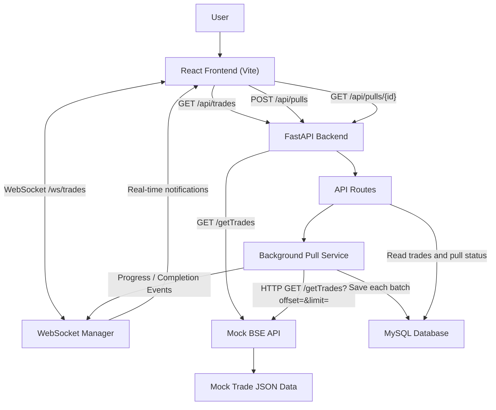

# System Architecture – Real-Time Trade Dashboard

## 1. Project Overview

The Real-Time Trade Dashboard is a web-based application that fetches synthetic trade records from a mock BSE API, processes them in batches, stores them in a MySQL database, and displays the records on a React dashboard.

The application uses FastAPI for backend APIs, background processing for data ingestion, SQLAlchemy for database operations, and WebSockets for real-time progress notifications.

## 2. Technology Stack

| Component | Technology |
|---|---|
| Frontend | React.js, Vite |
| Backend | Python, FastAPI |
| Database | MySQL |
| ORM | SQLAlchemy |
| HTTP Client | HTTPX |
| Real-Time Communication | WebSocket |
| Data Format | JSON |
| API Documentation | Swagger UI |

## 3. High-Level Architecture

## 4. Main Components

### 4.1 React Frontend

The frontend is developed using React and Vite.

Responsibilities:
- Display trade records in a dashboard.
- Show trade statistics.
- Allow users to start a new data pull.
- Display pull status and progress.
- Provide search, filtering, sorting, and pagination.
- Receive real-time updates through WebSocket communication.

### 4.2 FastAPI Backend

The backend is developed using FastAPI.

Responsibilities:
- Expose REST API endpoints.
- Handle incoming requests from the frontend.
- Create and manage pull jobs.
- Execute background trade data ingestion.
- Retrieve trade records and pull status from MySQL.
- Manage WebSocket connections.

### 4.3 Mock BSE API

The mock BSE API simulates an external trade data provider.

Responsibilities:
- Generate 3,000 synthetic trade records.
- Store generated records in a JSON file.
- Return trade records in batches of 100.
- Support offset-based pagination.
- Simulate API response delays.

**Note:** The trade records are synthetic and are not actual BSE market data.

### 4.4 Background Pull Service

The background pull service handles trade ingestion without making the frontend wait for the complete operation.

Workflow:
1. Receive a newly created pull job.
2. Fetch trade records from the mock BSE API.
3. Retrieve records in batches of 100.
4. Save each batch independently in MySQL.
5. Skip duplicate trade IDs.
6. Update the pull job's progress and status.
7. Send progress and completion notifications through WebSockets.

### 4.5 MySQL Database

MySQL stores the trade records and pull job information.

Main tables:

**Trades**
- id
- trade_id
- client
- symbol
- quantity
- price
- timestamp

**Pull Jobs**
- id
- status
- started_at
- completed_at
- total_fetched
- error_message

SQLAlchemy is used to interact with the database.

### 4.6 WebSocket Communication

The application uses WebSockets for real-time communication between the backend and frontend.

Endpoint:

`/ws/trades`

The WebSocket manager maintains active connections and broadcasts events such as:
- Pull progress
- Pull completed
- Pull failed

This allows the dashboard to update without requiring a manual browser refresh.

## 5. Data Flow

### Trade Data Ingestion

1. The user clicks the Start Pull button.
2. The frontend sends a POST request to `/api/pulls`.
3. FastAPI creates a pull job and schedules background processing.
4. The frontend receives the pull job ID and response immediately.
5. The background service requests trade batches from `/getTrades`.
6. Each batch is saved independently in MySQL.
7. The pull job's progress is updated.
8. Progress notifications are broadcast through WebSockets.
9. When all batches are processed, the job is marked completed.
10. The frontend refreshes the trade records and displays the latest information.

### Dashboard Data Retrieval

1. The frontend requests `/api/trades`.
2. FastAPI retrieves records from MySQL.
3. The backend returns trade records in JSON format.
4. React displays the records in the dashboard.

## 6. API Endpoints

| Method | Endpoint | Purpose |
|---|---|---|
| GET | `/` | Check backend availability |
| GET | `/getTrades` | Fetch mock trade records |
| GET | `/api/trades` | Retrieve stored trades |
| POST | `/api/pulls` | Start a new background pull |
| GET | `/api/pulls/{id}` | Retrieve pull job status |
| WebSocket | `/ws/trades` | Receive real-time notifications |

## 7. Background Processing

Trade ingestion runs as a FastAPI background task.

Instead of fetching all records in a single request, the service retrieves records in smaller batches of 100.

Each batch is saved independently, which helps preserve previously processed data if a later batch fails.

The pull job status is maintained in the database.

## 8. Error Handling and Duplicate Prevention

- Database operations are handled using SQLAlchemy.
- Duplicate trade IDs are skipped using the unique constraint on `trade_id`.
- Pull failures are recorded in the pull job's error message.
- WebSocket connections are removed when clients disconnect.
- The frontend can reconnect when a WebSocket connection is lost.

