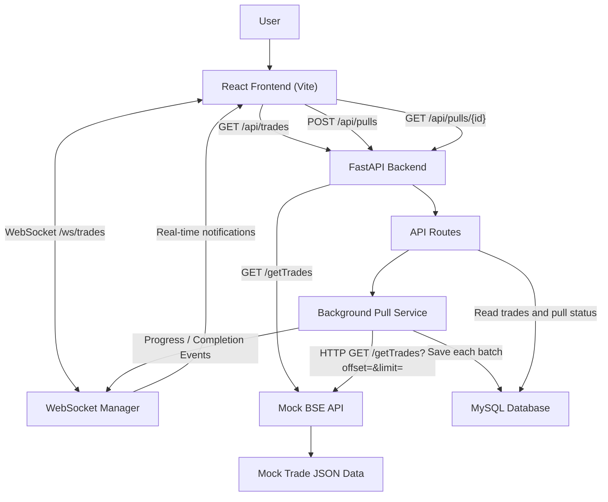

# System Architecture – Real-Time Trade Dashboard

## 1. Project Overview

The Real-Time Trade Dashboard is a web-based application designed to fetch, process, store, and display trade records through an interactive dashboard.

The application simulates an external BSE trade data provider using a Mock BSE API that generates 3,000 synthetic trade records.

The backend retrieves trade records in batches of 100, stores them in a MySQL database, and tracks the progress of each data ingestion job.

The frontend displays trade information and receives real-time progress and completion notifications through WebSocket communication.

The primary objective is to keep the dashboard responsive while large volumes of trade data are fetched and processed in the background.

**Note:** The application uses synthetic trade data and is not connected to the actual BSE trading system.

---

## 2. Technology Stack

| Component | Technology |
|---|---|
| Frontend | React.js, Vite |
| Backend | Python, FastAPI |
| Database | MySQL |
| ORM | SQLAlchemy |
| HTTP Client | HTTPX |
| Real-Time Communication | WebSocket |
| Data Format | JSON |
| API Documentation | Swagger UI |

---

## 3. High-Level Architecture

The application follows a client-server architecture. The React frontend communicates with the FastAPI backend through REST APIs and WebSockets.

The backend interacts with the Mock BSE API to retrieve trade records and uses MySQL for persistent storage.

---

## 4. Design Decisions – Why This Architecture?

The architecture was designed to keep the application responsive, maintainable, and capable of handling trade data ingestion without blocking user interactions.

Each technology and design decision serves a specific purpose.

### 4.1 React for the Frontend

React was selected because it supports reusable components and dynamic user interfaces.

The dashboard contains interactive elements such as:
- Trade statistics cards.
- Search and filtering.
- Sorting and pagination.
- Pull progress indicators.
- Connection status.

React allows the interface to update when new trade data or pull status information becomes available, improving the user experience and maintainability.

### 4.2 FastAPI for the Backend

FastAPI was selected because it provides a lightweight framework for building REST APIs and supports asynchronous operations.

It also provides:
- Automatic API documentation through Swagger UI.
- Background task execution.
- WebSocket support.
- Request validation.

These features make it suitable for managing API requests, background data ingestion, and real-time communication within the application.

### 4.3 Background Processing for Trade Ingestion

Fetching all trade records directly during a frontend request would require the user to wait until the entire operation finishes.

To avoid this, the application uses background processing.

When the user clicks the Start Pull button:
1. FastAPI creates a new pull job.
2. The backend returns the pull job ID immediately.
3. The background service starts fetching trade records independently.
4. The frontend remains available while ingestion continues.

This approach improves responsiveness and separates the initiation of a pull job from the actual data processing.

### 4.4 Batch Processing for Data Fetching

Instead of fetching all 3,000 trade records in a single request, the application retrieves records in batches of 100.

Batch processing was selected because it:
- Reduces the size of individual API responses.
- Makes data ingestion easier to manage.
- Allows each batch to be saved independently.
- Helps preserve previously processed batches if a later batch fails.
- Makes it easier to track ingestion progress.

It also provides a straightforward way to simulate a longer-running data ingestion process.

### 4.5 MySQL for Persistent Storage

MySQL was selected to store trade records and pull job information persistently.

A relational database provides structured storage and supports querying, sorting, filtering, and pagination.

The application uses separate tables for:
- Trade records.
- Pull job information.

A unique constraint on the trade ID helps prevent duplicate records during repeated pulls.

SQLAlchemy is used as the ORM to simplify database operations and model management.

### 4.6 WebSockets for Real-Time Updates

Repeatedly sending HTTP requests to check pull progress would create unnecessary network requests.

WebSockets provide a persistent communication channel between the frontend and backend.

The backend can send notifications when relevant events occur, including:
- Pull progress.
- Pull completion.
- Pull failure.

This allows the dashboard to receive updates without requiring manual page refreshes.

### 4.7 Modular Project Structure

The backend separates API routes, database models, business logic, and WebSocket management into different modules.

This separation of responsibilities makes the code easier to understand, maintain, test, and debug.

For example, the Mock BSE API can be replaced with a real authorized data provider without requiring a complete redesign of the frontend.

---

## 5. Main System Components

### 5.1 React Frontend

The frontend is developed using React and Vite.

Responsibilities:
- Display trade records in a dashboard.
- Show trade statistics.
- Allow users to start a new data pull.
- Display pull status and progress.
- Provide search, filtering, sorting, and pagination.
- Receive real-time updates through WebSocket communication.
- Refresh trade data after a successful pull.

### 5.2 FastAPI Backend

The backend is developed using FastAPI.

Responsibilities:
- Expose REST API endpoints.
- Handle incoming requests from the frontend.
- Create and manage pull jobs.
- Execute background trade data ingestion.
- Retrieve trade records and pull status from MySQL.
- Manage WebSocket connections.

### 5.3 Mock BSE API

The Mock BSE API simulates an external trade data provider.

Responsibilities:
- Generate 3,000 synthetic trade records.
- Store generated records in a JSON file.
- Return trade records in batches.
- Support offset-based pagination.
- Simulate API response delays.

### 5.4 Background Pull Service

The background pull service handles trade ingestion without making the frontend wait for the complete operation.

Responsibilities:
- Fetch trade records from the Mock BSE API.
- Retrieve records in batches of 100.
- Save each batch independently in MySQL.
- Skip duplicate trade IDs.
- Update pull job status and progress.
- Send progress and completion notifications through WebSockets.

### 5.5 MySQL Database

MySQL stores trade records and pull job information.

**Trades table**

| Column | Purpose |
|---|---|
| id | Primary key |
| trade_id | Unique trade identifier |
| client | Client associated with the trade |
| symbol | Trading symbol |
| quantity | Number of units traded |
| price | Trade price |
| timestamp | Trade timestamp |

**Pull Jobs table**

| Column | Purpose |
|---|---|
| id | Pull job identifier |
| status | Current job status |
| started_at | Job start time |
| completed_at | Job completion time |
| total_fetched | Number of records fetched |
| error_message | Error details if the job fails |

---

## 6. Data Flow

### 6.1 Trade Data Ingestion Flow

1. The user clicks the Start Pull button on the React dashboard.
2. The frontend sends a POST request to `/api/pulls`.
3. FastAPI creates a new pull job in MySQL.
4. The backend schedules background processing and immediately returns the pull job ID.
5. The background service sends HTTP requests to the Mock BSE API using HTTPX.
6. The Mock BSE API returns records in batches of 100.
7. Each batch is saved independently in MySQL.
8. Duplicate trade IDs are skipped.
9. The pull job progress and status are updated.
10. The backend broadcasts progress notifications through WebSockets.
11. Once all batches are processed, the job is marked as completed.
12. The frontend receives the completion notification and refreshes the dashboard.

### 6.2 Dashboard Data Retrieval Flow

1. The React frontend requests `/api/trades`.
2. FastAPI receives the request.
3. The backend retrieves stored trade records from MySQL using SQLAlchemy.
4. The backend returns the records in JSON format.
5. React displays the records in the dashboard.

### 6.3 Pull Status Retrieval Flow

1. The frontend requests `/api/pulls/{id}`.
2. FastAPI retrieves the corresponding pull job from MySQL.
3. The backend returns the current status, start time, completion time, and total fetched records.
4. The frontend displays the pull job information.

---

## 7. API Endpoints

| Method | Endpoint | Purpose |
|---|---|---|
| GET | `/` | Check backend availability |
| GET | `/getTrades` | Fetch mock trade records |
| GET | `/api/trades` | Retrieve stored trade records |
| POST | `/api/pulls` | Start a new background pull |
| GET | `/api/pulls/{id}` | Retrieve pull job status |
| WebSocket | `/ws/trades` | Receive real-time notifications |

---

## 8. Background Processing and Reliability

Trade ingestion runs as a FastAPI background task.

Instead of fetching all records in one operation, the service retrieves records in smaller batches of 100.

Each batch is committed independently to the database. This helps preserve previously processed data if a later batch encounters an error.

The pull job status is maintained in MySQL so that the frontend can retrieve the current job information.

Duplicate trade IDs are prevented using a unique database constraint.

---

## 9. WebSocket Communication

The application uses a WebSocket endpoint:

`/ws/trades`

The WebSocket manager maintains active client connections and broadcasts events from the backend.

The main events include:
- `pull_progress`
- `pull_completed`
- `pull_failed`

These events allow the frontend to respond to changes in the ingestion process without continuously polling the server.

---

## 10. Error Handling

The application includes basic error-handling mechanisms:

- Database operations are handled through SQLAlchemy sessions.
- Duplicate trade IDs are skipped using the unique constraint.
- Pull failures are recorded in the pull job's error message.
- WebSocket connections are removed when clients disconnect.
- The frontend can reconnect when a WebSocket connection is lost.
- API errors are returned through appropriate HTTP responses.

---

## 12. Design Summary

The architecture focuses on three main goals:

**1. Responsiveness**

Background processing allows users to continue interacting with the dashboard while trade data is being fetched and stored.

**2. Reliability**

Independent batch commits, database constraints, and pull job tracking help maintain consistent data and provide visibility into ingestion operations.

**3. Real-Time Visibility**

WebSocket notifications keep users informed about the progress and outcome of each pull job without requiring manual refreshes.

Overall, this architecture provides a simple, modular, and maintainable foundation for a real-time trade monitoring application while allowing future scalability improvements.
